# Laporan Praktikum 8 — PHP dan Database MySQL

| | |
|---|---|
| **Nama** | Sairin bin Rubad |
| **NIM** | 312510134 |
| **Mata Kuliah** | Pemrograman Web OBE |
| **Program Studi** | Teknik Informatika |
| **Topik** | Praktikum 8: PHP dan Database MySQL (CRUD) |
| **Repository** | Lab8Web |

---

## Tujuan Praktikum
1. Memahami konsep dasar database.
2. Memahami konsep dasar CRUD (*Create, Read, Update, Delete*) menggunakan PHP.
3. Membuat program CRUD sederhana menggunakan PHP dan MySQL.

## Struktur Folder
```
Lab8Web/
├── gambar/            # folder penyimpanan gambar barang
├── screenshots/       # screenshot hasil praktikum
├── database.sql       # script pembuatan database, tabel, dan data awal
├── koneksi.php        # koneksi ke database
├── index.php          # Read   : menampilkan data
├── tambah.php         # Create : menambah data
├── ubah.php           # Update : mengubah data
├── hapus.php          # Delete : menghapus data
├── style.css          # tampilan
└── README.md
```

---

## 1. Persiapan

### 1.1 Menjalankan MySQL Server
Buka **XAMPP Control Panel**, lalu klik **Start** pada modul **Apache** dan **MySQL**. Kedua modul berwarna hijau menandakan server sudah berjalan (Apache port 80/443 dan MySQL port 3306).

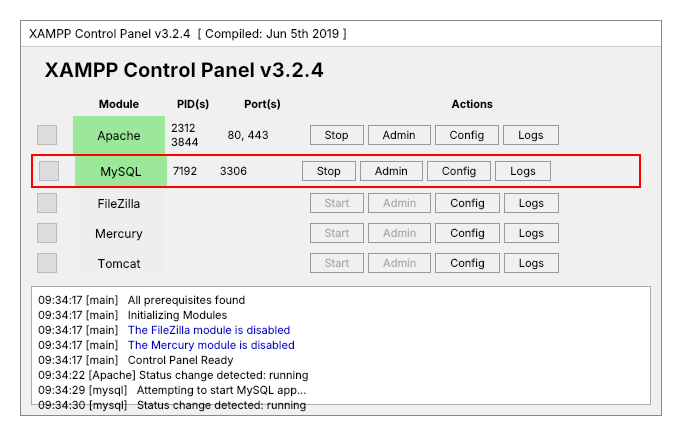

### 1.2 Mengakses MySQL Client (phpMyAdmin)
Buka browser dan akses `http://localhost/phpmyadmin/`. phpMyAdmin dipakai untuk membuat database, tabel, dan mengisi data.

---

## 2. Membuat Database: Studi Kasus Data Barang

### 2.1 Membuat Database dan Tabel
Pada tab **SQL** di phpMyAdmin, dijalankan perintah berikut:

```sql
CREATE DATABASE latihan1;

CREATE TABLE data_barang (
  id_barang int(10) auto_increment Primary Key,
  kategori varchar(30),
  nama varchar(50),
  gambar varchar(100),
  harga_beli decimal(10,0),
  harga_jual decimal(10,0),
  stok int(4)
);
```

Penjelasan: database bernama `latihan1` berisi tabel `data_barang`. Kolom `id_barang` adalah *primary key* yang bertambah otomatis (`auto_increment`) sehingga setiap barang punya ID unik. Kolom `gambar` menyimpan nama file gambar, sedangkan file gambarnya disimpan di folder `gambar/`.

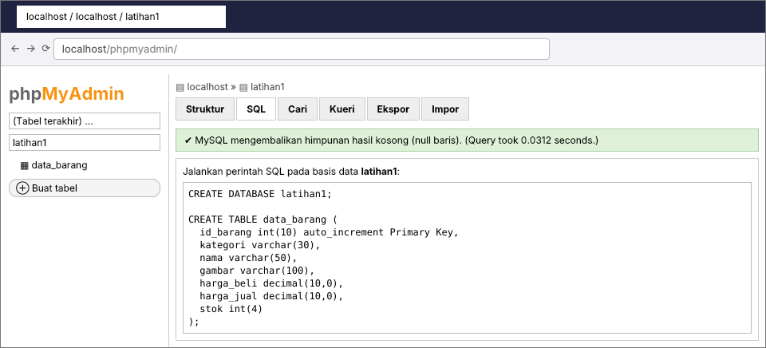

### 2.2 Menambahkan Data
```sql
INSERT INTO data_barang (kategori, nama, gambar, harga_beli, harga_jual, stok)
VALUES ('Elektronik', 'HP Samsung Android', 'hp_samsung.jpg', 2000000, 2400000, 5),
('Elektronik', 'HP Xiaomi Android', 'hp_xiaomi.jpg', 1000000, 1400000, 5),
('Elektronik', 'HP OPPO Android', 'hp_oppo.jpg', 1800000, 2300000, 5);
```

Penjelasan: perintah `INSERT INTO` memasukkan tiga baris data awal sekaligus. Kolom `id_barang` tidak diisi karena dibuat otomatis oleh MySQL.

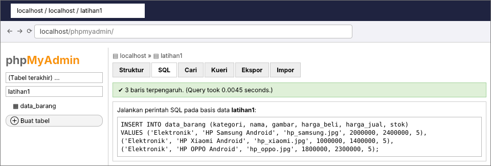

Hasil `SELECT * FROM data_barang;` menampilkan 3 baris data:

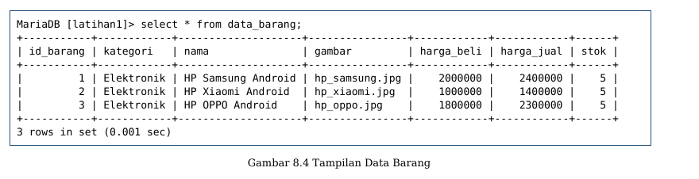

---

## 3. Membuat Program CRUD

### 3.1 Membuat Folder Project
Dibuat folder `lab8_php_database` di dalam root web server (`d:\xampp\htdocs`).

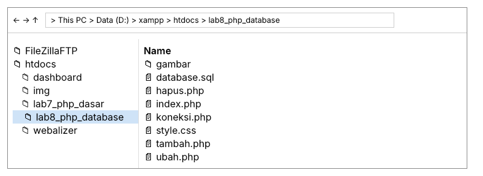

Folder diakses melalui `http://localhost/lab8_php_database/`. Karena belum ada file index, Apache menampilkan daftar isi direktori.

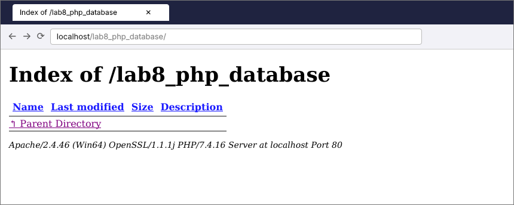

### 3.2 Membuat File Koneksi Database — `koneksi.php`
```php
<?php
$host = "localhost";
$user = "root";
$pass = "";
$db   = "latihan1";

$conn = mysqli_connect($host, $user, $pass, $db);
if ($conn == false)
{
    echo "Koneksi ke server gagal.";
    die();
} #else echo "Koneksi berhasil";
?>
```

Penjelasan: `mysqli_connect()` menghubungkan PHP ke MySQL memakai host, user, password, dan nama database. Bila gagal, pesan error ditampilkan dan program dihentikan dengan `die()`. Untuk pengujian, tanda `#` pada `echo "Koneksi berhasil"` di-*uncomment* sehingga muncul pesan berikut:

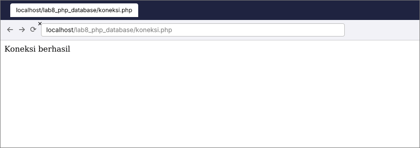

### 3.3 Menampilkan Data (Read) — `index.php`
`index.php` memanggil `koneksi.php` dengan `include`, menjalankan query `SELECT * FROM data_barang`, lalu menampilkan setiap baris hasilnya ke tabel HTML dengan perulangan `while` dan `mysqli_fetch_array()`. Jika tabel kosong, tampil tulisan "Belum ada data". Kolom **Aksi** berisi link **Ubah** dan **Hapus** yang membawa `id_barang`, serta ada link **Tambah Barang** di atas tabel.

```php
$sql = 'SELECT * FROM data_barang';
$result = mysqli_query($conn, $sql);
```

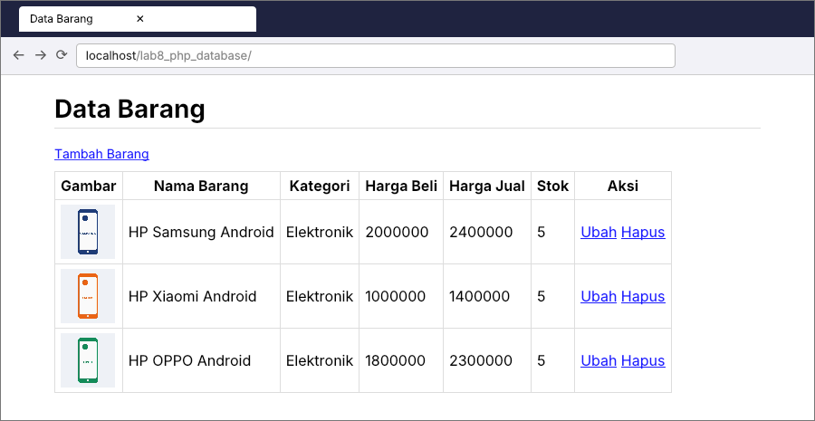

### 3.4 Menambah Data (Create) — `tambah.php`
Halaman ini berisi form (`method="post"`, `enctype="multipart/form-data"` agar bisa upload gambar). Saat tombol **Simpan** ditekan:
1. Data form diambil dari `$_POST` dan file dari `$_FILES`.
2. File gambar dipindahkan ke folder `gambar/` dengan `move_uploaded_file()`.
3. Data disimpan ke database dengan `INSERT INTO data_barang ...`.
4. Pengguna diarahkan kembali ke `index.php` memakai `header('location: index.php')`.

Form tambah barang (kosong):


Form diisi dengan data **Laptop ASUS VivoBook** (kategori Komputer, harga jual 7200000, harga beli 6500000, stok 10, gambar `laptop_asus.jpg`):

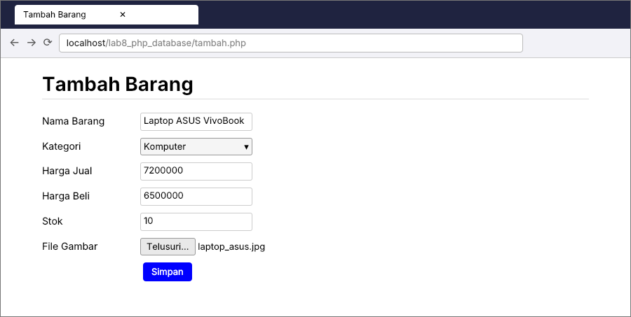

Setelah disimpan, data baru muncul di tabel:

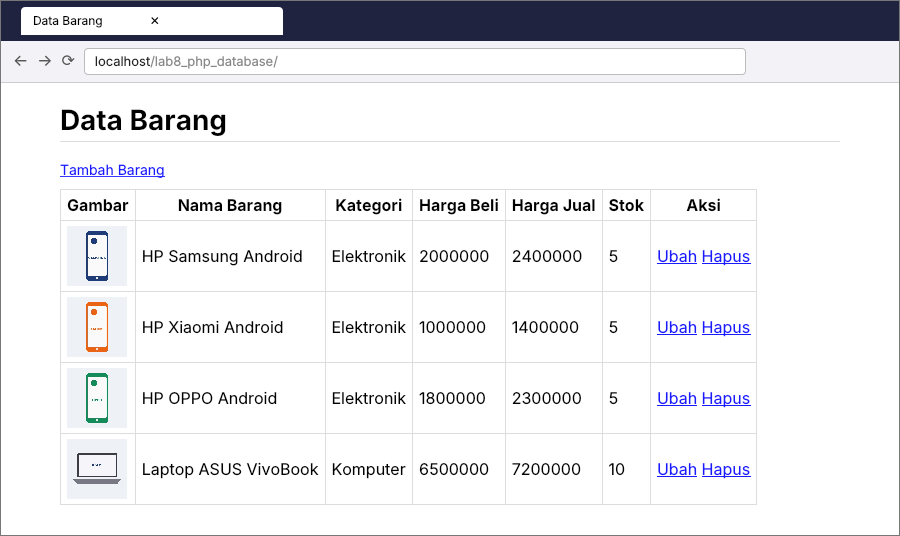

### 3.5 Mengubah Data (Update) — `ubah.php`
Halaman ini menerima `id` lewat URL (`ubah.php?id=2`), mengambil data lama dari database, dan menampilkannya di form (nilai awal pada setiap input). Fungsi `is_select()` dipakai agar pilihan kategori yang sesuai otomatis terpilih (`selected`). Saat **Simpan** ditekan, data diperbarui dengan `UPDATE data_barang SET ... WHERE id_barang = ...`. Gambar hanya diganti bila pengguna memilih file baru.

Contoh: data **HP Xiaomi Android** diubah, harga jual menjadi 1450000 dan stok menjadi 8.

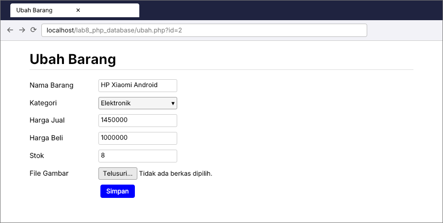

Hasil setelah diubah:


### 3.6 Menghapus Data (Delete) — `hapus.php`
Halaman ini mengambil `id` dari URL lalu menjalankan `DELETE FROM data_barang WHERE id_barang = ...`, kemudian kembali ke `index.php`. Contoh: data **HP OPPO Android** (id 3) dihapus melalui link **Hapus**.

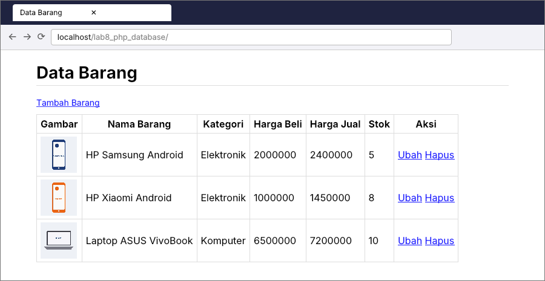

---

## Perbaikan Kode dari Modul
Selama praktikum, beberapa bagian kode pada modul diperbaiki agar program berjalan benar:

| No | Masalah pada modul | Perbaikan |
|----|--------------------|-----------|
| 1 | `enctype="multipart/formdata"` di `ubah.php` salah ketik, sehingga upload gambar gagal | Diganti menjadi `multipart/form-data` |
| 2 | Fungsi `is_select()` selalu dibandingkan dengan `'Komputer'` untuk semua opsi kategori | Setiap opsi dibandingkan dengan nilainya sendiri (`Komputer`, `Elektronik`, `Hand Phone`) |
| 3 | Urutan header tabel (Harga Jual, Harga Beli) tidak sesuai urutan datanya | Header diurutkan menjadi Harga Beli, Harga Jual |
| 4 | `index.php` memakai `gambar/<nama file>`, sedangkan `tambah.php` menyimpan `gambar/<nama file>` sehingga path ganda | Database hanya menyimpan nama file, folder `gambar/` ditambahkan di `index.php` |
| 5 | Link **Tambah Barang**, **Ubah**, dan **Hapus** belum ada di `index.php` | Ditambahkan |
| 6 | Query memakai variabel langsung (rawan *SQL Injection*) | Diganti memakai *prepared statement* (`mysqli_prepare`) |
| 7 | Kolom `nama` di SQL `varchar(30)` padahal tabel desain `50` | Disamakan menjadi `varchar(50)` |

## Cara Menjalankan
1. Jalankan **Apache** dan **MySQL** di XAMPP.
2. Import `database.sql` melalui phpMyAdmin (atau jalankan isinya di tab SQL).
3. Salin folder project ke `htdocs/lab8_php_database`.
4. Buka `http://localhost/lab8_php_database/`.

## Kesimpulan
Dengan praktikum ini, saya memahami cara menghubungkan PHP dengan database MySQL menggunakan `mysqli`, serta cara membuat aplikasi CRUD sederhana: **Create** (`tambah.php`), **Read** (`index.php`), **Update** (`ubah.php`), dan **Delete** (`hapus.php`), termasuk upload gambar dan penggunaan *prepared statement* untuk keamanan query.
